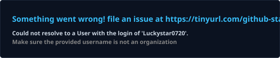

# 👋 Hello.

### Fullstack Developer | AI Product Builder | Automation Engineer

Building scalable web applications, intelligent AI products, and automation systems that solve real business problems.

  

  
  
  

---

## 👨‍💻 About Me

I'm a Fullstack Developer and AI Product Builder focused on designing, developing, and deploying modern digital products.

I enjoy turning complex ideas into practical, scalable solutions.

- 🤖 Building AI-powered applications and intelligent assistants.
- ⚡ Developing fullstack SaaS platforms.
- 🔗 Automating business workflows with n8n and APIs.
- 🧠 Exploring LLMs, AI agents, and RAG architectures.
- ☁️ Building and deploying cloud-ready applications.
- 🚀 Interested in collaborating with founders and ambitious teams.

## 🛠️ Tech Stack

**Frontend**

**Backend**

**AI & Automation**

**Database & Infrastructure**

## 📊 GitHub Analytics

  
  

## 📈 GitHub Analytics

  

## 🚀 What I'm Building

- AI-powered applications and assistants.
- Fullstack SaaS platforms.
- Business workflow automation systems.
- CRM integrations and intelligent lead management.
- Modern web applications with scalable architectures.

## 🎯 Current Focus

- AI Agents and LLM applications.
- Retrieval-Augmented Generation (RAG).
- Workflow automation with n8n.
- Backend architecture and system design.
- Scalable SaaS development.

## 🤝 Let's Connect

I'm open to collaborating with startup founders, developers, and teams building innovative products.

  
  <!-- Replace with your actual LinkedIn profile URL -->
  

---

  <b>Building intelligent products. Automating possibilities. Creating impact. 🚀</b>

